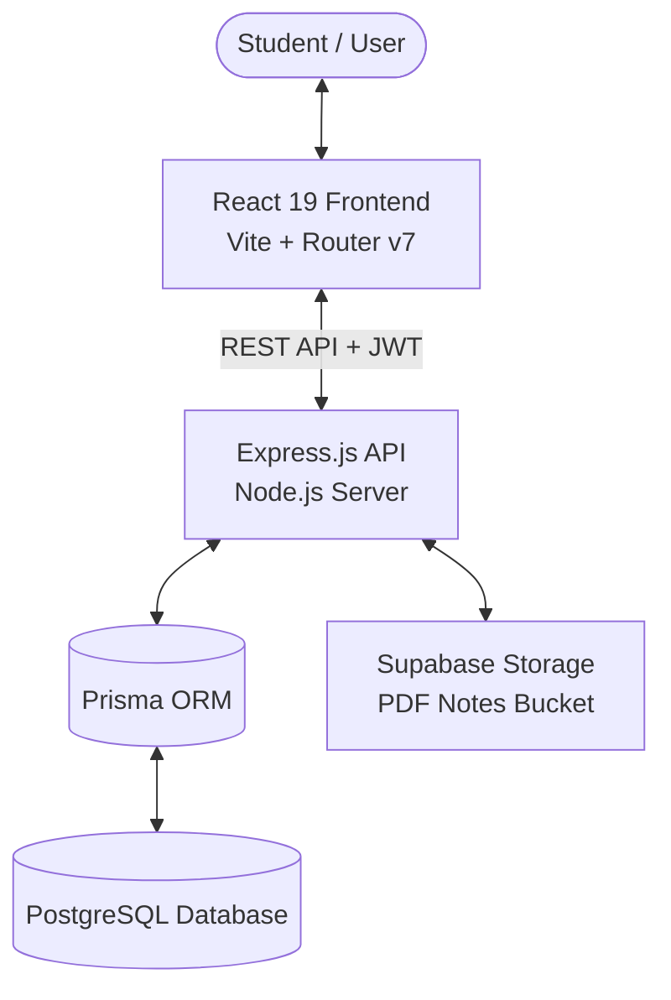

# NoteNest — Student Notes Sharing Platform 📚

> **CSE Coursework Project: Full Stack Web Development (Year 2)**  
> NoteNest is a modern academic notes-sharing web platform where college students can upload, search, bookmark, and study peer-shared lecture notes and materials.

---

## 🌿 Repository Branch Structure

To maintain clean separation between frontend and backend workflows, all active application code is organized into two dedicated branches:

```
NoteNest (Repository)
│
├── 🌿 main         -> Project overview, architecture docs & guidelines (You are here)
├── 🌿 frontend     -> React 19 + Vite client application
└── 🌿 backend      -> Node.js + Express + Prisma + PostgreSQL API
```

---

## 🚀 How to Access & Work with Branches

### 1. Frontend Development (`frontend` branch)
Contains the user interface built with React 19, Vite, React Router v7, Lucide React, and Plain Vanilla CSS.

```bash
# Switch to the frontend branch
git checkout frontend

# Navigate to the frontend directory
cd frontend

# Install dependencies and start the dev server
npm install
npm run dev
```
> The frontend dev server will start at: `http://localhost:5173`

---

### 2. Backend Development (`backend` branch)
Contains the RESTful API built with Express, Prisma ORM, PostgreSQL, Supabase storage for PDF notes, and JWT authentication.

```bash
# Switch to the backend branch
git checkout backend

# Navigate to the backend directory
cd backend

# Install dependencies
npm install

# Setup environment variables
cp .env.example .env

# Run database migrations and seed data
npx prisma migrate dev --name init
npm run prisma:seed

# Start the API server
npm run dev
```
> The API server will start at: `http://localhost:5000/api`

---

## 🏛️ Architecture Overview



---

## 👥 Team & Responsibilities
- **Frontend Development:** UI/UX, responsive layouts, search & filter interactions, client-side routing, and state management.
- **Backend Development:** RESTful API design, database schemas, authentication middleware, file upload pipelines, and admin moderation.
